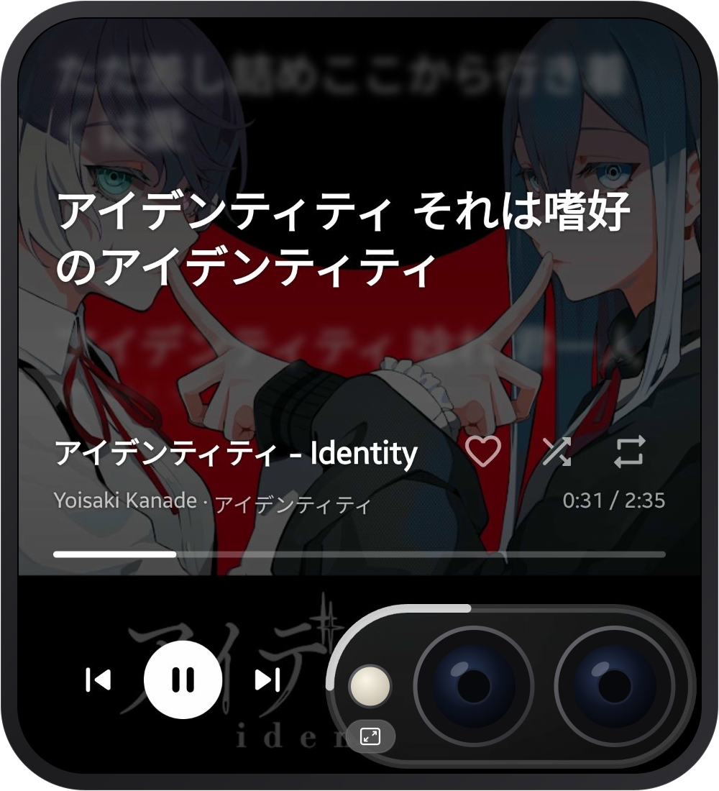

# Flip Music

**屏幕再小，听歌也尽兴。**

专为小折叠设备外屏模式适配的音乐播放器。

官网与下载：<https://player.pjsk.store>

<p align="center"></p>

<p align="center"><sub>截图中的歌曲翻唱与插画版权归《世界计划 彩色舞台 feat. 初音未来》（SEGA / Colorful Palette / Crypton Future Media）及原曲作者等相关权利方所有；Galaxy Z Flip 系列外观设计归 Samsung 所有。仅用于展示界面效果。</sub></p>

## 不同外屏都合适

每家折叠屏的外屏比例都不一样，有偏宽的，有偏长的。Flip Music 会按不同屏幕比例重新排版，不会只是把大屏界面缩小塞进去。

## 双平台适配

在国内用网易云，在国外用 YouTube Music，设置里随时切换，人在哪都有歌听。App 从不保存密码。

## 三星 Galaxy Z Flip7 / Flip8 专属特性

- **1:1 外屏适配**：UI 专为 Galaxy Z Flip7 / Flip8 优化，不浪费 4.1 英寸外屏一丁点角落。
- **跑道形播放进度条**：官方做不到的，我们来做：不浪费外屏任何一块空间，不只是摄像头左侧区域，甚至摄像头周围。

## 小提示

三星手机要在外屏打开，先到 设置 › 高级功能 › 实验室 › 外屏上允许的应用，把 Flip Music 加进去。

## 反馈

遇到问题或者有想法，欢迎发邮件到 233.rinne@gmail.com。

## 声明

Flip Music 是非官方第三方客户端，与 Google、YouTube、网易云音乐、Samsung 无关。

关于网易云音乐：Flip Music 只使用网易云音乐网页版的官方接口。不登录账号时，能听的内容和网页版游客模式完全一样；需要会员的歌，要登录开通了会员的账号才能播放。我们不存在“通过技术手段破解、绕开限制，直接提供网易云音乐享有版权的音乐作品内容”的行为 :)

## 开源许可与参考资料

Flip Music 以 [GPL-3.0](LICENSE) 开源。

Flip Music 用到了这些开源项目，感谢它们的作者：

- [NewPipe Extractor](https://github.com/TeamNewPipe/NewPipeExtractor)：YouTube 音频流解析 · GPL-3.0
- [Android Jetpack](https://developer.android.com/jetpack/androidx)（Compose、Media3 / ExoPlayer、DataStore、WindowManager、Palette 等）· Apache-2.0
- [Kotlin](https://github.com/JetBrains/kotlin)、[kotlinx.coroutines](https://github.com/Kotlin/kotlinx.coroutines)、[kotlinx.serialization](https://github.com/Kotlin/kotlinx.serialization) · Apache-2.0
- [OkHttp](https://github.com/square/okhttp)：网络请求 · Apache-2.0
- [Coil](https://github.com/coil-kt/coil)：图片加载 · Apache-2.0
- [Material Icons](https://fonts.google.com/icons)：图标 · Apache-2.0

参考资料：

- [NeteaseCloudMusicApi](https://github.com/Binaryify/NeteaseCloudMusicApi)：网易云网页版接口与加密方式的参考 · MIT
- [LRCLIB](https://lrclib.net)：开放的歌词数据库，用于 YouTube Music 歌曲的歌词

## 构建

需要 JDK 17 和 Android SDK 36。

```bash
cd YouFlipMusic
./gradlew :app:assembleRelease
```

输出 `app/build/outputs/apk/release/app-release.apk`。

| 路径 | 内容 |
| --- | --- |
| `YouFlipMusic/` | Android App（Kotlin + Jetpack Compose + Media3） |
| `site/` | 官网页面，以及 `site/deploy/nginx.conf` 服务器配置 |
| `release.sh` | 编译、生成 `update.json`、发布到服务器 |
